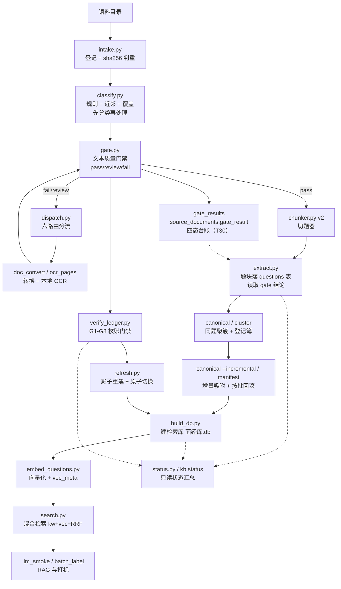
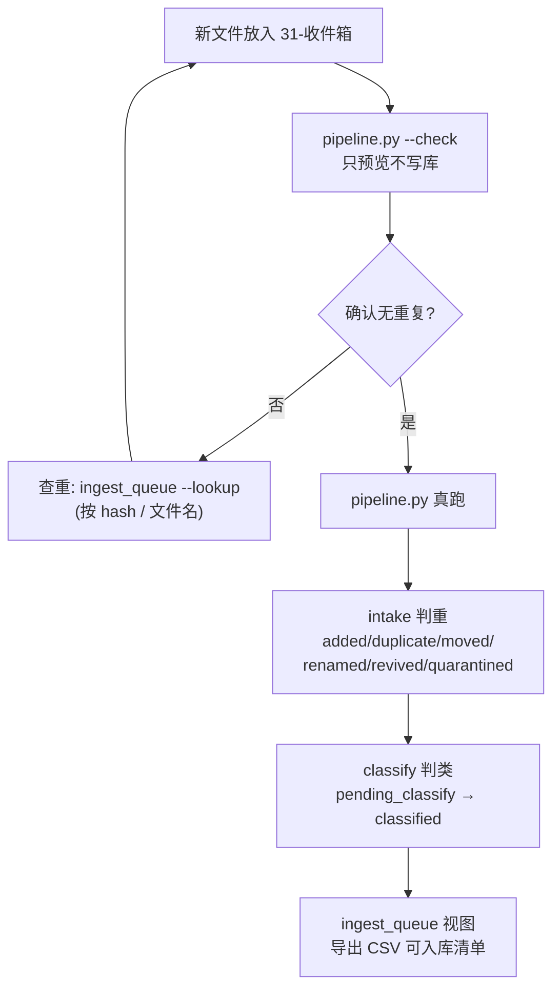
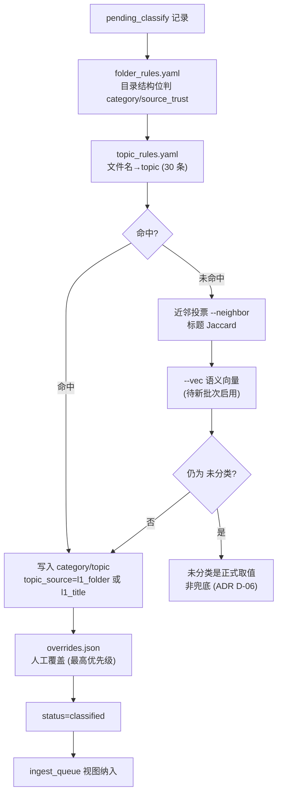
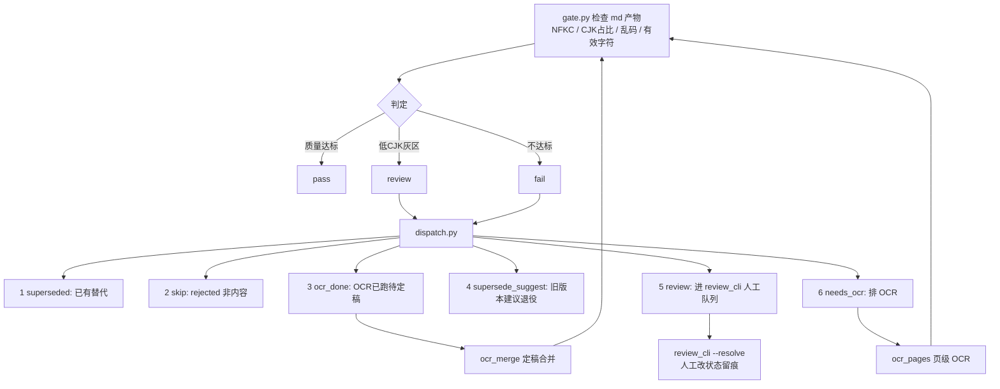
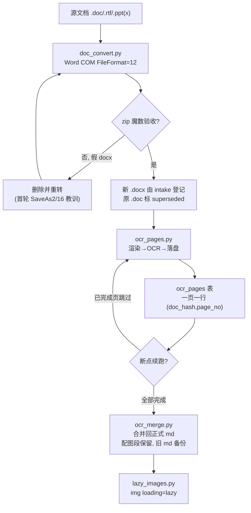
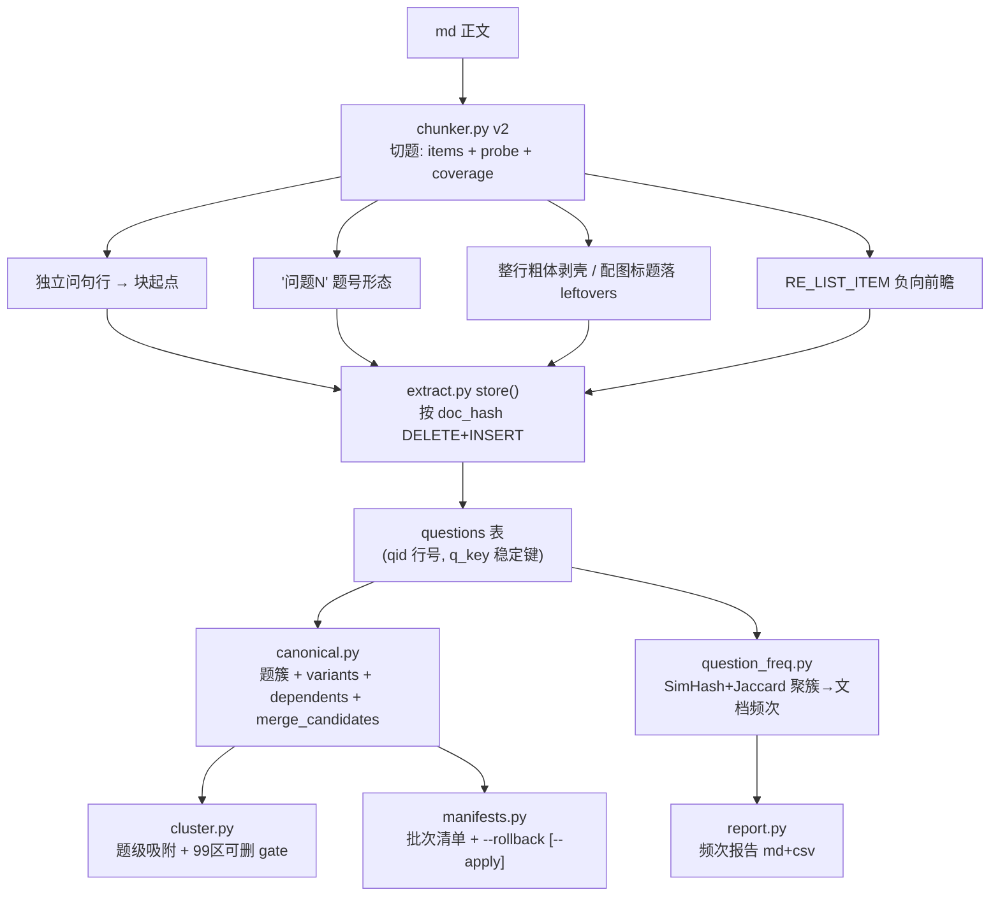
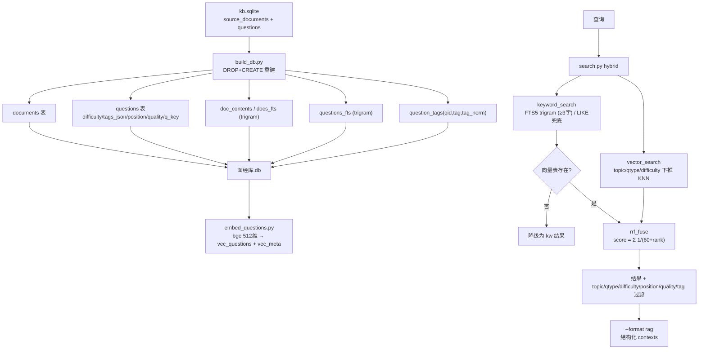
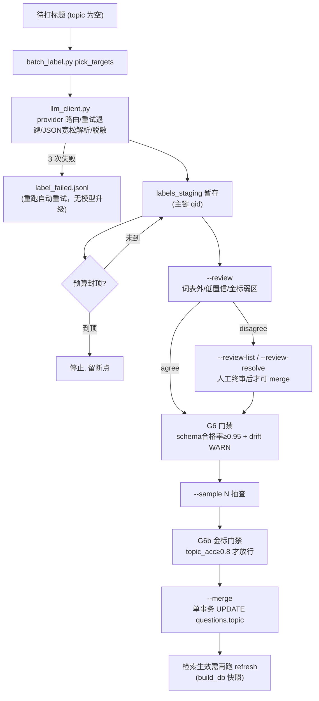
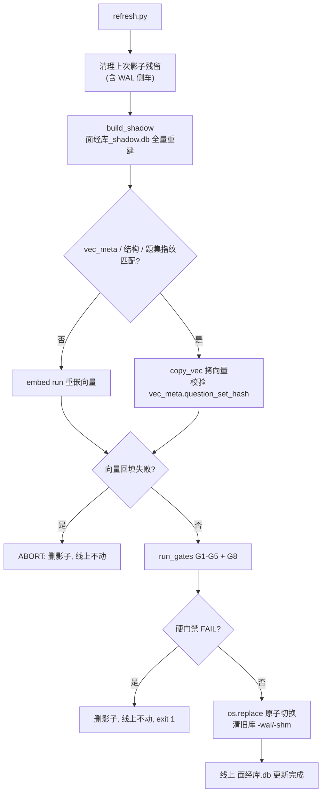
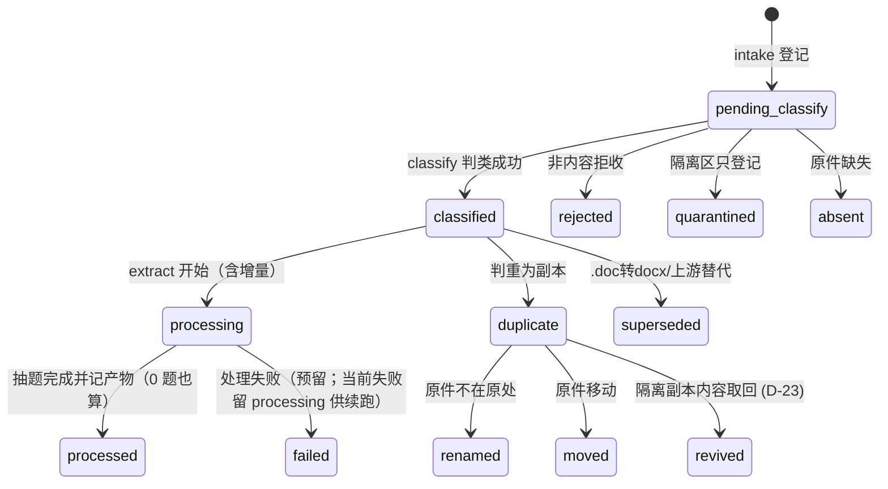

# 19-功能流程图（mianjing-kb 面经题库知识库）

> **本文是"现状流程"的唯一入口**（2026-11-19 起）：其他文档只描述设计意图或历史阶段，**不再重复维护一套文字流程**；
> 两者不一致时以本文 + 代码为准。阶段划分与编排层设计见 `docs/28`，方案缺陷与修复顺序见 `docs/27`。
> **状态**：现行（流程唯一入口） · **最后实质更新**：2026-11-19（已对齐 T29/T31/T22 代码现状）
> **适用方案版本**：v2-R3
> 本文用 Mermaid 图描述项目**已实现**的功能流程与状态机，图随源码走，结论可追溯到 `mianjing_kb/` 与 `meta/schema/`。
> 关联：`README.md`、`docs/README.md`（索引）、`docs/33-代码地图与维护索引-2026-11-19.md`（模块/表/测试定位）、
> `docs/00-决策记录.md`、`docs/03-未分类文档入库方案.md`、
> `docs/15-检验门禁与线上打标方案-2026-11-17.md`、`docs/17-项目审核与修复报告-2026-11-17.md`。
> 阅读提示：Mermaid 图在 VS Code / GitHub 的 Markdown 预览中直接渲染；纯文本环境可读图后的文字说明。

---

## 1. 全链路总览

从语料文件到可检索知识库的主链，每一步都有工具承接（审核报告 §二确认闭环）：

文字说明：主链为 `intake → classify → gate → chunker → extract → canonical/cluster → build_db → embed → search`，门禁与核账横切其中；`dispatch` 把 fail/review 件分流到转换/OCR/人工复核后再回到门禁。`gate --audit` 同时把结论写回 `gate_results` 与 `source_documents.gate_result`，`extract` 只抽 `pass`（`review/fail` 跳过；`--require-gate` 时无结论也跳过）。`verify_ledger` 是 G1–G8 的唯一实现；`refresh` 内置 G1–G5 + G8；`kb status` 只读汇总源/产物/题/标签/门禁/检索库状态，不写库。

## 2. 入库与批增流程

唯一新增入口是 `31-收件箱`，路径即语义（ADR D-20、README.md:33-35）：

**判重口径**（README.md:111-112）：`added` 新件 / `duplicate` 副本（原件仍在磁盘，只刷"最后见到"，不改路径）/ `moved`·`renamed`（原件已不在原处才改路径）/ `quarantined` 隔离区只登记。注意 `pipeline.py` 名为"一条命令"，实际只走到 ingest_queue，转换/OCR/抽题/建库仍在链外（审核报告 §二注）。

## 3. 分类流程

分类顺序不可逆，必须先分类再处理（ADR D-07）。三路判类 + 人工覆盖：

`"未分类"` 是正式取值不是兜底（ADR D-06）；人工覆盖表 `overrides.json` 优先级最高（`config.py:61-63`）。

## 4. 质量门禁与分流

门禁三态 pass/review/fail（README.md:25），fail/review 件进入六路由分流（`mianjing_kb/dispatch.py:3-11`）：

路由判据按序命中即定，输出 `build/dispatch_plan.csv`（`dispatch.py:34-45,84-91`）。三态报告阈值在 `mianjing_kb/gate.py`（可见字符 <100 → fail、异常字符 ≥0.02 → fail、CJK <0.15 → review）；四态台账阈值在 `mianjing_kb/kb/config.py`（乱码 >0.01、有效字符 <0.90、可见字符 <800）。报告先落盘再写库，`--strict` 在真覆盖 >0 或异常率 >`--max-abnormal`（默认 0.10）时返回 1；`--audit` 与 `--md-dir` 互斥。`pass` 只表示“没有可识别的非中文垃圾字符 + 长度/CJK 达标”，不等于文本可读；ToUnicode 错映射成正常汉字的 mojibake 仍需人工抽检。

## 5. 转换与 OCR 流程

`.doc` 必须先转 docx 再做后续处理；OCR 支持页级断点续跑：

zip 魔数验收是为了拦截"OLE 顶着 .docx 后缀"的假文件（README.md:132）；页级记录落 `ocr_pages` 表（`meta/schema/001_init.sql:74-82`）支撑断点续跑。

## 6. 抽题与同题聚簇

chunker v2 用 items+probe+coverage 结构，纯函数；落库幂等：

v2 增强后全量重切 18,642 → 32,087 题（v1→v2 时点，历史口径）；P0-1 单身份重跑后为 20,984 题，
T29 迁移 016 按 `(doc_hash, q_norm_hash)` 去重后为 **20,010 题**（-974），canonical **11,520**。
**注意**：`extract.store()` 的 DELETE+INSERT 仍会让 `qid` 重排，跨库定位必须用
`q_key = doc_hash:q_norm_hash`，不要用 `qid`（见 `docs/32` §5）。

**增量/重建口径（2026-11-19 修复）**：`canonical --incremental` 与全量 `--jac 0.7` 同口径，
≥0.7 吸附、0.65–0.7 只进 `merge_candidates`、<0.65 新簇；全量重建只清三张派生表
（variants/canonicals/dependents），**保留 merge_candidates**，并用成员重叠给 `canonical_id` 做粘性绑定。
候选由 `--candidates / --approve / --reject / --apply-candidates` 消费，不再是只增不减的死表。

**题池身份（P0-1 修正后，2026-11-19）**：进入 `extract` 的文档只带一个身份——源文档 `doc_hash`。
`20-题库MD/<cat>/<topic>/<stem>__<hash8>.md` 由 `kb/mdmap.py` 映射回源：hash8 精确优先、唯一 stem 次之、
同 stem 多候选按"非 md 源优先 + doc_hash 序"裁决；一个源有多份产物时只取主产物（其余留档不进池）；
无产物的源回退抽源文件；无对应源的孤儿 md 才保留 `md-mirror:` 身份。`build_db` 写 `doc_contents` 时
`doc_hash` 一律填源 hash，`mirror_hash` 仅作回链。因此同一原文只出一套题，`question_freq` 的
`COUNT(DISTINCT doc_hash)` 不再翻倍。门禁 `G8` 专查"有源回链却仍有镜像题行"的残留。
**2026-11-19 已全量重跑**：镜像题行清零（`purged_orphan_docs=1140`），T29 去重后题行 **20,010**、
canonical 11,520，见 `docs/29` §3。检索库 `面经库.db` 已于同日 **17:55** 由 `refresh --reembed`
重建并原子切换（20,010 题 / 20,010 向量，`vec_meta` 记录题集指纹）。

**T30 门禁前置（2026-11-19 接通）**：`extract` 在 `doc_pool` 之后按 `source_documents.gate_result`
或 `gate_results` 最新 `verdict`（按 `doc_hash`）过滤，只抽 `pass`；`low_cjk/garbled/non_content`
记入 `skipped_gate` 后跳过，不进 `questions`。默认只跳过已有结论的 review/fail，`--require-gate`
把无台账文档也跳过（新库/新语料全量启用时用）。全量抽取的 `purge_orphans` 仍用过滤前的身份池，
避免因门禁跳过而误删已存在的题。生产首次回写只覆盖 `convert_log` 的 423 件：`gate_results` 385 行、
`source_documents.gate_result` 非空 420；1,466 篇题池里 1,058 篇仍无结论，所以默认保留“无结论仍抽”，
`--require-gate` 只用于新批次全量门禁。

## 7. 建库与混合检索

检索库 `面经库.db` 由 `build_db.py` 全量重建，检索用 kw + vec 双路 RRF 融合：

RRF 公式 `score = Σ 1/(60+rank)`（`mianjing_kb/search.py:24,106-113`）；无向量表时自动降级为关键词检索
（`search.py:119-120`）。T1/T22 后：`topic/qtype/difficulty` 走 vec0 metadata 下推 KNN，
`position/quality/tag` 在 KNN 后过滤（过采样 `VEC_OVERSAMPLE=4`、`VEC_MAX_CANDIDATES=512`）；
`question_tags` 由 `tags_json` 展开，多个 `--tag` 为 AND。生产尚未全量打标时这些过滤字段为空，
查询会查空，属数据未就绪而非检索链路缺失。

## 8. LLM 打标流程

打标采用 staging 中间层，预算封顶、断点续跑、单事务 merge：

**已知缺口**（2026-11-19 复核更新）：人工金标（`--golden-sample/--golden-load` + G6b）、LLM 预审 + 人工终审（`--review/--review-list/--review-resolve`）**已实现**；T21 标签维度（`position/quality/canonical_q/tags` 归一 + `label_taxonomy` 配置表）**已落 staging 与 merge**。T22 的代码链路（`build_db` / `search` / vec metadata）**已实现**，但生产 `difficulty/tags/question_tags` 仍为 0 行，过滤实际查空，必须等全量打标 + 重建检索库后才可用。仍缺：**模型升级链**（单题重试 3 次失败只落 `label_failed.jsonl`，不切高级模型）、**T20 金标集**（`golden_labels=0`）、**T23**（单题单调用未改批量 prompt）。口径细节见 `docs/26`、`docs/32` 与 `docs/项目审核报告/待办清单-2026-11-19.md`。

## 9. 影子库原子切换与核账

`refresh.py` 把高风险重建放影子库，G1-G5 + G8 全过才切换（`mianjing_kb/refresh.py`）：

WAL 侧车（`-wal`/`-shm`）必须在切换后清理，否则旧 WAL 会硬套在新主文件上（Windows 实测坑，
`refresh.py:16-17,165-169`）。T29 后 `copy_vec` 不再按 rowid 盲拷：先加载 `sqlite_vec`、校验 vec0 schema
与 `questions` 元数据逐行一致，再校验源/影子 `vec_meta.question_set_hash`；结构/指纹不匹配自动 reembed，
显式 `--copy-vec` 失败即中止。

## 10. 主状态机（source_documents）

schema 定义 12 态（`meta/schema/001_init.sql:30-33`）；Q-3（2026-11-19）后 `processing/processed`
已是真实状态（由 `extract` 写入），`failed/duplicate/moved/renamed` 仍是预留/历史动作态。当前状态迁移：

12 态清单：`pending_classify / classified / processing / processed / rejected / failed / duplicate / moved / renamed / absent / superseded / quarantined`（`001_init.sql:30-33`）。`revived` 是 D-23 新增动作。Q-3 后 `processing/processed` 由 `extract` 真实写入，失败留 `processing` 作为断点；`failed/duplicate/moved/renamed` 仍无工具写入（预留/历史动作态）。

## 11. 关键数据流与事实源

| 数据 | 位置 | 定位 |
|---|---|---|
| 源文档事实源 | `kb.sqlite` 的 `source_documents` | 唯一事实源，scan 快照 `registry.json` 降级（README.md:151） |
| 文档产物台账 | `kb.sqlite` 的 `document_products` | `extract` 写、`refresh`/`status` 读；0 题也算已处理 |
| 题目事实源 | `kb.sqlite` 的 `questions`（含 `q_key` 稳定键） | 打标 merge 的落点；跨库定位用 `q_key`，不用 `qid` |
| 打标暂存/事实 | `labels_staging` / `label_facts` / `golden_labels` | staging → G6/G6b → merge；`label_facts` 按 `q_norm_hash` 共享语义标签 |
| 门禁结论 | `kb.sqlite` 的 `gate_results` / `source_documents.gate_result` | `gate --audit` 写入（四态）；`extract` 按 `doc_hash` 前置过滤。缺失产物只回写 `source_documents`，不写 `gate_results` |
| 检索库 | `面经库.db` | build_db 全量重建的快照；topic/标签是快照，需 refresh 才随打标更新 |
| 检索标签 | `面经库.db` 的 `question_tags` | 从 `tags_json` 展开，供 `search --tag` |
| 向量 | `面经库.db` 的 `vec_questions`（sqlite-vec，512 维） | KNN 检索；metadata `topic/qtype/difficulty/q_key` |
| 向量指纹 | `面经库.db` 的 `vec_meta` | `model/dim/question_set_hash/built_at`，`refresh` 校验 |
| 批次/回滚 | `build/manifests/<batch_id>.json` | canonical 增量批次清单，`kb manifest --rollback [--apply]` |
| 规则/覆盖 | `meta/*.yaml`、`meta/*.json` | 进 git，可版本化/人工修正 |
| 门禁/核账 | `gate_report.json`、`dispatch_plan.csv`、`backfill_plan.csv`、`skip_log.json` | "门禁即清单" |

三个高频易错点：① 打标 merge 只写 `kb.sqlite`，检索行为不变，必须再跑 `refresh`；
② 事实源是 `kb.sqlite`，`registry.json` 只是快照；③ `qid` 会因 `extract` 重排，跨库一律用 `q_key`。
